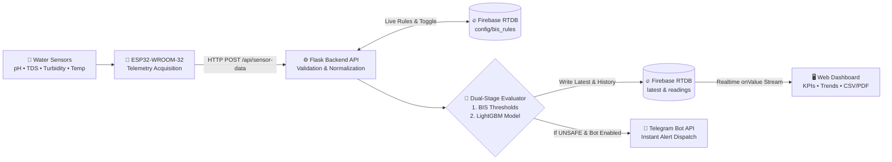

<div align="center">

# 💧 HydroSense 2.0
### Real-Time IoT & Edge-AI Water Quality Monitoring, Potability Classification & Alert System

An end-to-end IoT water quality intelligence platform combining multi-sensor telemetry, dynamic BIS threshold enforcement, LightGBM potability screening, instant Telegram alerting, and a real-time web command center.

[🌐 Live Dashboard](https://hydrosense-2-0.web.app) • [🏗️ System Architecture](#-system-architecture--workflow) • [✨ Features & Wow Factors](#-key-highlights--wow-factors) • [🛠️ Quick Start](#️-local-setup--deployment)

</div>

---

## 📌 Overview

**HydroSense 2.0** bridges embedded IoT sensing with cloud analytics and automated decision-making to evaluate water potability in real time. Built around an **ESP32-WROOM-32** node, a **Flask** backend service, **Firebase Realtime Database**, and a responsive web dashboard, the system continuously tracks four core water quality parameters:

| Parameter | Unit | Default BIS Safe Range | Role in Water Quality Assessment |
| :--- | :---: | :---: | :--- |
| **pH Level** | pH | `6.5 – 8.5` | Measures acidity/alkalinity balance critical for safe consumption |
| **TDS (Total Dissolved Solids)** | ppm | `≤ 500 ppm` | Quantifies dissolved inorganic salts and mineral concentration |
| **Turbidity** | NTU | `≤ 5.0 NTU` | Detects suspended particulates and optical water clarity |
| **Temperature** | °C | `15.0 – 35.0 °C` | Tracks thermal state and compensates sensor behavior |

---

## 🏗️ System Architecture & Workflow

HydroSense 2.0 follows a decoupled, event-driven IoT pipeline designed for low latency, live configurability, and clean separation between hardware ingestion, evaluation logic, and visualization:



### How Data Flows Step-by-Step

1. **Sensing & Edge Acquisition:** The ESP32-WROOM-32 node samples Temperature, pH, TDS, and Turbidity sensors and transmits JSON telemetry to the backend `/api/sensor-data` endpoint.
2. **Dynamic Rule Synchronization:** The backend reads live threshold boundaries (`min_ph`, `max_ph`, `max_tds`, `max_turbidity`) and alert preferences (`telegram_enabled`) from Firebase (`config/bis_rules`) with local caching and safe defaults—eliminating server redeploys when limits change.
3. **Dual-Stage Potability Evaluation:**
   * **Stage 1 (BIS Rule Gate):** Checks incoming readings against active Bureau of Indian Standards (BIS) limits. Any boundary breach immediately flags the sample as `UNSAFE (NON-POTABLE)`.
   * **Stage 2 (ML Screening — Toggleable via `ML_ENABLED`):** When `ML_ENABLED=true`, readings passing BIS thresholds are evaluated by a trained **LightGBM** model to catch subtle multi-parameter anomalies. Setting `ML_ENABLED=false` switches seamlessly to pure rule-based evaluation.
4. **Cloud Persistence & Instant Alerting:** Normalized readings and classification results are stored in Firebase Realtime Database (`latest/<device_id>` and `readings/<device_id>`). If a sample is unsafe and Telegram alerts are enabled, an automated alert is pushed to Telegram.
5. **Real-Time Web Command Center:** Hosted on Firebase Hosting, the dashboard subscribes directly to Firebase streams (`onValue`) to render live KPI cards, sparklines, timestamp-based online/offline presence, historical analytics, CSV exports, and PDF reports.

---

## ✨ Key Highlights & Wow Factors

* ⚡ **Zero-Redeploy Dynamic BIS Thresholds:** Operators can update safe pH, TDS, and Turbidity limits as well as mute/unmute Telegram notifications directly from the dashboard Settings panel—instantly syncing across UI alerts and backend evaluation.
* 🔄 **Switchable ML / Rule-Based Engine (`ML_ENABLED`):** Supports both hybrid BIS + LightGBM inference and deterministic Threshold-Only mode via a single environment flag, making it ideal for iterative sensor calibration and custom dataset retraining.
* 💓 **Timestamp-Based Device Presence Detection:** Instead of relying on static flags, the dashboard evaluates telemetry freshness (`30s` heartbeat window) to accurately indicate `Live / Online` vs `Offline` node status and last-seen diagnostics.
* 📊 **Historical Analytics & Smart CSV Export:** Filter stored Firebase telemetry by preset windows (`24H`, `7D`, `30D`, `All`) or custom date ranges with live row-count and file-size (`KB/MB`) estimation before downloading clean `.csv` datasets.
* 📄 **Official PDF Report Generator:** One-click A4 report generation featuring institute branding, active threshold comparisons, potability verdicts, and authorized signatory blocks.
* 🛡️ **Guarded Operator Controls:** Hidden operator modal accessible from the top-right profile icon with Device ID + verification check protection for clearing test logs before deploying calibrated sensors.
* 🌓 **Responsive Dark & Light Themes:** Adaptive UI built for desktop control rooms, tablets, and mobile browsers.

---

## 📂 Repository Structure

```text
HydroSense-2.0/
├── backend/
│   ├── app.py                     # Flask REST API (/api/health, /api/sensor-data, /api/latest, /api/history)
│   ├── config.py                  # Environment & runtime configuration
│   ├── firebase_service.py        # Firebase Admin SDK writer (latest & readings nodes)
│   ├── requirements.txt           # Backend Python dependencies
│   ├── model/                     # Trained LightGBM artifacts (.joblib, .txt, .json)
│   └── services/
│       ├── ml_service.py          # Dual-stage BIS rules + LightGBM inference service
│       └── alert_service.py       # Telegram Bot notification dispatcher
├── dashboard/
│   ├── public/                    # Firebase Hosting production web app
│   │   ├── index.html             # Multi-view dashboard UI & PDF report template
│   │   ├── css/style.css          # Responsive dark/light theme stylesheet
│   │   ├── js/firebase-config.js  # Firebase client configuration & DEVICE_ID
│   │   ├── js/firebase-live.js    # Realtime DB listeners & config/cleanup writers
│   │   ├── js/dashboard.js        # Charts, filters, CSV/PDF export, workflow & operator modal
│   │   └── assets/                # Institute logo & static visual assets
│   ├── templates/                 # Flask-served HTML templates
│   └── static/                    # Flask-served static assets
├── esp32/
│   └── hydrosense_esp32.ino       # ESP32-WROOM-32 sensor firmware
├── firebase.json                  # Firebase Hosting configuration
└── .firebaserc                    # Firebase project alias mapping
```

---

## 🔥 Firebase Realtime Database Schema

```json
{
  "config": {
    "bis_rules": {
      "min_ph": 6.5,
      "max_ph": 8.5,
      "max_tds": 500,
      "max_turbidity": 5.0,
      "telegram_enabled": true,
      "updated_at": "2026-11-20T16:30:00.000Z"
    }
  },
  "latest": {
    "HYDRO_ESP32_01": {
      "device_id": "HYDRO_ESP32_01",
      "Temperature": 24.8,
      "pH": 7.12,
      "TDS": 318,
      "Turbidity": 1.4,
      "prediction": "SAFE",
      "prediction_source": "LIGHTGBM_BOOSTER",
      "data_source": "ESP32",
      "timestamp": "2026-11-20T16:30:05.000Z"
    }
  },
  "readings": {
    "HYDRO_ESP32_01": {
      "-PushKey01": { "...": "Historical time-series telemetry records" }
    }
  }
}
```

---

## 🛠️ Local Setup & Deployment

### 1. Backend API (Flask)

```powershell
cd backend
python -m venv .venv
# Windows PowerShell:
.\.venv\Scripts\Activate.ps1
pip install -r requirements.txt
python app.py
```

Configure `backend/.env` (or Render Environment Variables):

```env
PORT=5000
ML_ENABLED=true
FIREBASE_DATABASE_URL=https://hydrosense-2-0-default-rtdb.asia-southeast1.firebasedatabase.app
FIREBASE_CREDENTIALS_PATH=hydrosense-2-0-firebase-adminsdk.json
TELEGRAM_BOT_TOKEN=your_telegram_bot_token
TELEGRAM_CHAT_ID=your_telegram_chat_id
DASHBOARD_LIVE_URL=https://hydrosense-2-0.web.app
```

### 2. Frontend Preview & Firebase Hosting Deploy

```powershell
# Local static preview
cd dashboard/public
python -m http.server 8000

# Deploy to Firebase Hosting (from project root)
cd ../..
firebase deploy --only hosting
```

---

## 🔌 API Endpoints Reference

| Method | Endpoint | Description |
| :---: | :--- | :--- |
| `GET` | `/api/health` | Returns backend health status, `ml_enabled` state, and latest prediction source |
| `POST` | `/api/sensor-data` | Ingests sensor JSON (`pH`, `TDS`, `Turbidity`, `Temperature`), evaluates potability, stores in Firebase, and triggers Telegram alerts if unsafe |
| `GET` | `/api/latest` | Returns the most recent processed reading held in backend memory |
| `GET` | `/api/history` | Returns recent in-memory readings buffer |

---

<div align="center">
  Built with ❤️ for Smart Water Quality Monitoring • <strong>HydroSense 2.0</strong>
</div>